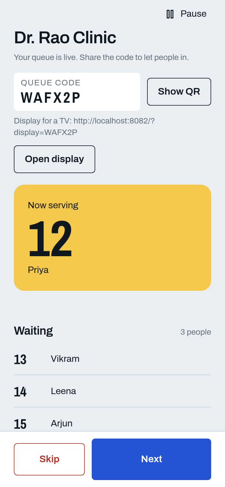
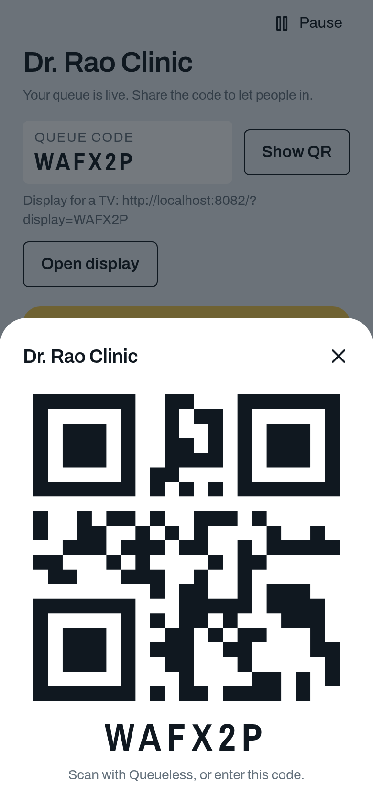
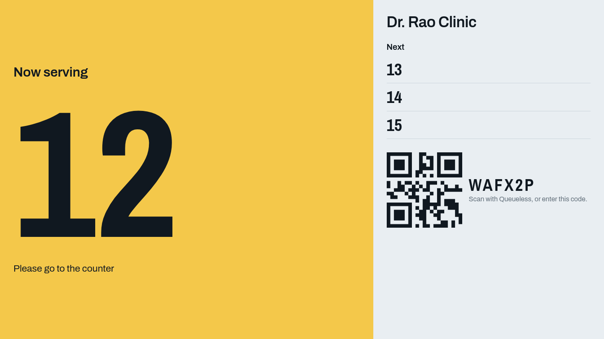
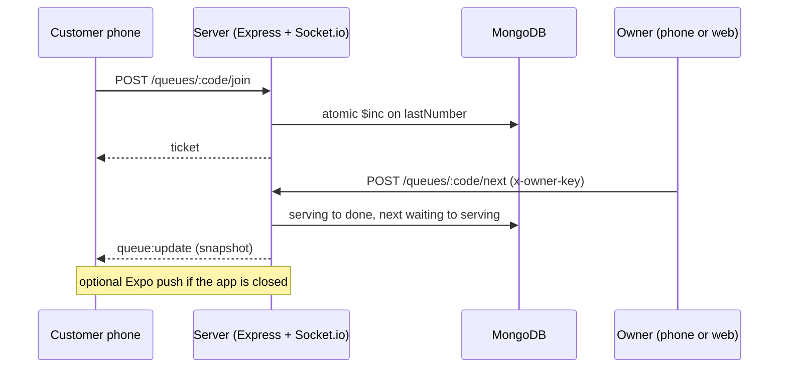

<div align="center">

# Queueless

**A live digital queue for clinics, shops and service counters.**
The owner shows a QR code. Customers scan it, get a token, and watch their place move in real time.


[Features](#features) · [How it works](#how-it-works) · [Quick start](#quick-start) · [API](#api) · [Notifications](#notifications) · [Roadmap](#limitations-and-roadmap)

</div>

<!-- Live demo: add the deployed URL here once there is one. -->

## The problem

Small clinics and shops run on a crowd standing around a door. People do not know how long they will wait, so they stay put. The owner has no clean way to call people in order, and no record of how long service takes. Enterprise queue systems need hardware, accounts and setup.

Queueless needs a phone and ten seconds: open a queue, show the QR, press **Next**.

## Screenshots

<table>
  <tr>
    <td align="center"><br/><sub><b>Owner dashboard</b><br/>serve, skip, pause, close</sub></td>
    <td align="center"><br/><sub><b>Join QR</b><br/>readable from across a counter</sub></td>
  </tr>
  <tr>
    <td colspan="2" align="center"><br/><sub><b>Shop display</b><br/>the wall screen: rolling number, next up, join QR</sub></td>
  </tr>
</table>

The customer app (join, live ticket, alerts) runs on a phone through Expo.

## Features

**Customer**
- Join by scanning the QR in-app, or by typing the 6-character code. Optional first name.
- Live ticket: your number, who is being served, people ahead, estimated wait. The screen changes colour with state: blue waiting, yellow your turn.
- **Leave-in timer.** Say how far away you are (5, 10, 20 or 30 min) and the ticket tells you when to set off, counting down and following the line.
- A buzz and a "Head back to the shop" prompt when 2 or fewer people are ahead. When you are called, a banner and a buzz on any screen, plus a system notification in development or production builds.
- Hold tickets in several queues at once, with a My tickets screen to open or leave each.
- The app reopens on your ticket.

**Owner** (phone or browser)
- Open a queue in seconds: shop name and a starting minutes-per-person estimate.
- Next, Skip, Recall a no-show to the back of the line, Pause joining, Close with a day summary.
- Named waiting list, visible only to the owner.

**Shop display** (browser)
- A full-screen page for a TV: the serving number in giant rolling digits, the next five numbers, and the join QR. Public and read-only, with numbers only and no names.

## How it works



*You ask by REST, you are told by socket.* REST carries every action; Socket.io only pushes one shared snapshot to everyone in the queue's room.

| Decision | Why |
|---|---|
| Token numbers come from one atomic MongoDB `$inc` | Two people scanning at the same instant can never get the same number |
| The public snapshot holds numbers only | One customer never sees another's name; names go to the owner over a keyed route |
| Each phone finds its own place in the snapshot | One broadcast serves every customer |
| Clients re-send `room:join` on every reconnect | A Wi-Fi blip heals itself: the server replies with a fresh snapshot |
| No accounts: a random `ownerKey` proves ownership | No sign-up, passwords or sessions. Trade-off: a lost phone loses the queue |
| In-app QR scanning (`QUEUELESS:<CODE>`) | Opening a system-camera QR needs deep links and a published app |

**Wait estimate.** `ceil(ahead × avg + (someoneServing ? avg / 2 : 0))`, where `avg` is the mean of the last 10 real service times, or the owner's guess until 3 exist. Skipped and abandoned tickets are excluded.
**Leave-in.** `max(0, wait − travel − 2 min)`, re-computed on every update.

## Tech stack

| Layer | Technology |
|---|---|
| App | React Native 0.86, Expo SDK 57, React Navigation, Animated and LayoutAnimation, AsyncStorage, expo-camera, expo-haptics, expo-notifications |
| Web | The same codebase through React Native Web: owner console and shop display (customer screens are not bundled) |
| Server | Node 20.19+, Express 5, Socket.io 4, Mongoose 9 |
| Database | MongoDB (local or Atlas) |
| Language | JavaScript throughout |

## Quick start

**Needs:** Node 20.19.4 or newer (`node -v`), MongoDB running locally or an Atlas connection string, Expo Go on a phone, and the phone and computer on the same Wi-Fi.

```bash
git clone git@github.com:subhaan0804/Queueless.git && cd Queueless

cd server && npm install
cp .env.example .env      # Windows: Copy-Item .env.example .env. Edit MONGO_URI for Atlas
npm run dev               # prints the addresses the server is reachable at

# in a second terminal, from the repo root
cd app && npm install
npx expo start            # scan the QR with Expo Go
npx expo start --web      # or: the owner console in a browser
```

No IP address needs editing: the phone asks the Expo dev server where the computer is and uses port 4000. For two-person demos use two phones, or a phone plus the web console.

## Configuration

| File | Variable | Purpose |
|---|---|---|
| `server/.env` | `MONGO_URI` | **Required.** MongoDB connection string |
| `server/.env` | `PORT` | API port, default `4000` |
| `server/.env` | `MONGO_DB_NAME` | Optional database name override |
| `server/.env` | `EXPO_PUSH_URL` | Enables server push for closed apps (see Notifications) |
| `app/.env` | `EXPO_PUBLIC_API_URL` | Optional. Overrides the auto-detected server address, needed for `--tunnel`, built apps or a remote server |

`.env` files are git-ignored. Restart with `npx expo start -c` after changing `app/.env`.

## API

REST under `/api`. Owner routes need the `x-owner-key` header returned when the queue is created.

| Method | Route | Who | Purpose |
|---|---|---|---|
| POST | `/queues` | anyone | Create a queue |
| GET | `/queues/:code` | anyone | Public snapshot |
| POST | `/queues/:code/join` | anyone | Take the next token |
| GET | `/tickets/:id` | holder | Ticket status |
| POST | `/tickets/:id/leave` | holder | Leave while waiting |
| POST | `/tickets/:id/notifications` | holder | Register an Expo push token |
| GET | `/queues/:code/owner` | owner | Named serving, waiting and skipped lists |
| POST | `/queues/:code/next` · `skip` | owner | Advance the line |
| POST | `/queues/:code/recall/:ticketId` | owner | Return a skipped ticket to the back |
| POST | `/queues/:code/pause` · `close` | owner | Pause joining, close with a summary |

Sockets: `room:join` (client to server, then a fresh snapshot comes back) and `queue:update` (server to room). Errors use 400, 403, 404 and 409 with a readable `error` message.

## Notifications

| Layer | Expo Go | Dev or production build |
|---|---|---|
| Banner and haptics while the app is open | Yes | Yes |
| System notification while the app is backgrounded | No | Yes |
| Leave-in reminder scheduled on the phone | No | Yes |
| Server push to a closed app | No | Yes, with an EAS project id (Android also needs Firebase Cloud Messaging credentials) |

Expo Go cannot load the notifications library on Android, so the app skips it there. Push is best effort and never delays the line.

## Project structure

```text
app/                          Expo app (phone + web)
  src/screens/                Home, JoinQueue, MyTicket, Tickets, StartQueue, OwnerDashboard, DaySummary, Display
  src/components/ hooks/ lib/ UI, live-queue and alert hooks, API, storage, ETA
  src/Navigator.js            Phone navigation        (.web.js: owner console + display only)
server/src/
  routes/                     queues (public), owner (keyed), tickets
  models/  lib/               Queue, Ticket · snapshot, auth, push, code generation
docs/                         README screenshots
PRD.md  VIVA.md               Product specification · presentation guide
```

## Troubleshooting

| Symptom | Fix |
|---|---|
| "Cannot reach the server at http://X:4000" | The message names the address tried. It must match one the server printed at startup. Same Wi-Fi? Firewall allowing port 4000? Guest or "client isolation" networks block phone-to-laptop traffic |
| Using `--tunnel` or a built app | Set `EXPO_PUBLIC_API_URL` in `app/.env`, then `npx expo start -c` |
| `MONGO_URI is not set` | Create `server/.env` from `server/.env.example` |
| `MongoDB connection failed` | Local MongoDB not running, or for Atlas: IP not allowed in Network Access, wrong password (avoid special characters), or no database name in the URI |
| `EADDRINUSE ... 4000` | Port taken. Stop the other process, or change `PORT` and set `EXPO_PUBLIC_API_URL` to match |
| Install errors | Node is older than 20.19.4 |

## Limitations and roadmap

**Limitations**
- No accounts: the owner key lives on one device, so a lost phone loses the queue, and the phone app and web console cannot share a queue.
- Built for a trusted network: no HTTPS, rate limiting or abuse protection.
- The estimate does not model different service types.
- The leave-in time is a prediction from the last update; a reminder already scheduled on a sleeping phone cannot be revised.
- Verified through scripted end-to-end checks, but no automated test suite is committed yet.

**Next**
- Owner accounts, so queues survive a lost device and work across phone and browser
- Services with their own durations, for a better estimate
- Automated tests for queue transitions, authorization and concurrent joins
- HTTPS and a hosted deployment

## Docs and contributors

[`PRD.md`](PRD.md) is the product and interface specification. [`VIVA.md`](VIVA.md) splits the project into four parts with presentation questions.

Built by **Subhaan Shaikh** and **Rijhan**.
